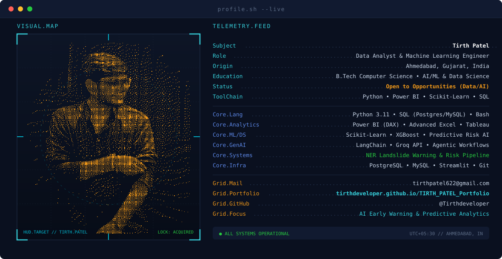

<div align="center">

<picture>
  <source media="(prefers-color-scheme: dark)" srcset="./assets/dark.svg" />
  <source media="(prefers-color-scheme: light)" srcset="./assets/light.svg" />
  
</picture>

</div>

<br/>

<div align="center">
  
</div>


<p align="center">
  <a href="https://tirthdeveloper.github.io/TIRTH_PATEL_Portfolio/"></a>
  &nbsp;
  <a href="http://www.linkedin.com/in/patel-tirth-421b9a34a"></a>
  &nbsp;
  <a href="mailto:tirthpatel622@gmail.com"></a>
  &nbsp;
  <a href="https://tirthdeveloper.github.io/TIRTH_PATEL_Portfolio/#contact"></a>
</p>

---

### 💻 Executive Telemetry // About Me

```yaml
Analyst: Tirth Patel
Specialization: Data Analytics, Predictive Machine Learning, Relational SQL, BI Architecture
Education: B.Tech Computer Science | Data Science & AI/ML Certification
Location: Ahmedabad, Gujarat, India
Status: Open for Data Analyst, Business Intelligence, Python/SQL & AI/ML Roles
Portfolio: https://tirthdeveloper.github.io/TIRTH_PATEL_Portfolio/
Contact: tirthpatel622@gmail.com | +91 96386 36364
```

- 📊 **Data Analytics & BI**: Processing 10,000+ transactional records, designing star-schema data models, authoring dynamic DAX measures, and architecting executive Power BI dashboards with real-time KPI telemetry.
- 🧠 **Machine Learning & AI**: Building end-to-end predictive pipelines with Scikit-learn and XGBoost for classification, regression, natural disaster early warning systems, and Streamlit web deployment.
- 🗄️ **Relational SQL Architecture**: Architecting normalized 3NF schemas in MySQL & PostgreSQL, writing high-performance multi-table joins, CTEs, and window functions for clinical and enterprise workloads.
- 🤖 **Generative AI & Agentic Systems**: Implementing autonomous tool-calling agents and LLM-powered assistants using LangChain and Groq API for automated workflow synthesis and smart learning assistance.


### 🌟 Flagship Showcase // Live Interactive Portfolio

<table>
<tr>
<td width="100%">

### 🌐 [Tirth Patel — Cyber HUD Data & AI Portfolio](https://tirthdeveloper.github.io/TIRTH_PATEL_Portfolio/)

A production-grade, cyberpunk-inspired interactive developer portfolio engineered with **high-performance modern frontend architecture**. Features interactive analytical telemetry, early warning system showcases, interactive project matrices, resume inspection viewer, terminal aesthetic HUD, and real-time contact hooks.

<br/>


<br/>

👉 **[🚀 Launch Live Cyber Portfolio Website](https://tirthdeveloper.github.io/TIRTH_PATEL_Portfolio/)** &nbsp;&bull;&nbsp; 📦 **[Explore Portfolio Source Code](https://github.com/Tirthdeveloper/TIRTH_PATEL_Portfolio)**

</td>
</tr>
</table>


### 📦 Featured Public Repositories

| Repository | Domain | Core Stack | Key Engineering Highlights | Source |
| :--- | :---: | :---: | :--- | :---: |
| **[NER-Landslide-Early-Warning-System](https://github.com/Tirthdeveloper/NER-Landslide-Early-Warning-System)** | Hazard Intelligence | `Python` `ML` `Geotechnical` | Predictive risk assessment and early alert notification pipeline modeling slope stability, precipitation, and seismic triggers. | [Explore ↗](https://github.com/Tirthdeveloper/NER-Landslide-Early-Warning-System) |
| **[crop_recommendation_powerbi](https://github.com/Tirthdeveloper/crop_recommendation_powerbi)** | Business Intelligence | `Power BI` `DAX` `Data Modeling` | Agricultural analytics dashboard modeling soil nutrients (N, P, K) and weather dynamics with interactive KPI drilldowns. | [Explore ↗](https://github.com/Tirthdeveloper/crop_recommendation_powerbi) |
| **[AQI_Analysis](https://github.com/Tirthdeveloper/AQI_Analysis)** | Environmental Data Science | `Python` `Pandas` `Seaborn` `EDA` | Comprehensive exploratory data analysis, outlier treatment, and pollutant correlation models ($PM_{2.5}$, $PM_{10}$, $NO_2$, $SO_2$). | [Explore ↗](https://github.com/Tirthdeveloper/AQI_Analysis) |
| **[SQL_FINAL_EXAM](https://github.com/Tirthdeveloper/SQL_FINAL_EXAM)** | SQL Architecture | `MySQL` `Relational DB` `Window Funcs` | Normalized 3NF schemas, CTEs, aggregation pipelines, and customer/patient cohort segmentation. | [Explore ↗](https://github.com/Tirthdeveloper/SQL_FINAL_EXAM) |
| **[AI-Travel-Agent](https://github.com/Tirthdeveloper/AI-Travel-Agent)** | Autonomous Agents | `LangChain` `Groq API` `Python` | Autonomous tool-calling agent orchestrating multi-step itinerary synthesis, budget calculation, and live telemetry retrieval. | [Explore ↗](https://github.com/Tirthdeveloper/AI-Travel-Agent) |
| **[India-economy_analysis_project](https://github.com/Tirthdeveloper/India-economy_analysis_project)** | Economic Data Analytics | `Pandas` `NumPy` `Matplotlib` | Macroeconomic trend telemetry, GDP growth trajectory, sector distribution, and demographic correlation models. | [Explore ↗](https://github.com/Tirthdeveloper/India-economy_analysis_project) |

<p align="center">
  <a href="https://github.com/Tirthdeveloper?tab=repositories">
    
  </a>
</p>


### ⚡ Technical Arsenal &amp; Ecosystem

<div align="center">
  
</div>

<br/>

<div align="center">

| Category | Verified Technologies &amp; Tools |
| :--- | :--- |
| **Programming &amp; Scripting** | `Python (Pandas, NumPy)` &bull; `SQL (MySQL, PostgreSQL)` &bull; `JavaScript` &bull; `HTML5 / CSS3` &bull; `Bash` |
| **Data Analytics &amp; BI** | `Power BI (DAX, Power Query)` &bull; `Advanced Excel (Pivot, VLOOKUP)` &bull; `Matplotlib` &bull; `Seaborn` &bull; `EDA` |
| **Machine Learning &amp; AI** | `Scikit-learn` &bull; `XGBoost` &bull; `Supervised Learning` &bull; `Predictive Risk Systems` &bull; `Streamlit` |
| **Generative AI &amp; LLMs** | `LangChain` &bull; `Groq API` &bull; `Autonomous Agents` &bull; `Prompt Engineering` &bull; `RAG Architectures` |
| **Databases &amp; Tools** | `MySQL Workbench` &bull; `PostgreSQL` &bull; `Git &amp; GitHub` &bull; `VS Code` &bull; `Jupyter Notebook` &bull; `GitHub Pages` |

</div>


### 📊 GitHub Telemetry &amp; Statistics

<div align="center">

<!-- Streak Stats -->
<picture>
  
</picture>

<br/><br/>

<!-- Stats and top langs grid -->


<br/><br/>

<!-- Followers and Profile Views badges -->

&nbsp;&nbsp;


</div>


### 🐍 Contribution Activity Grid Snake

<div align="center">

<picture>
  <source media="(prefers-color-scheme: dark)" srcset="https://raw.githubusercontent.com/Tirthdeveloper/Tirthdeveloper/output/github-contribution-grid-snake-dark.svg?v=1" />
  <source media="(prefers-color-scheme: light)" srcset="https://raw.githubusercontent.com/Tirthdeveloper/Tirthdeveloper/output/github-contribution-grid-snake.svg?v=1" />
  
</picture>

</div>


### 📬 Contact &amp; Connect

<div align="center">

<a href="http://www.linkedin.com/in/patel-tirth-421b9a34a">
  
</a>
&nbsp;&nbsp;
<a href="mailto:tirthpatel622@gmail.com">
  
</a>
&nbsp;&nbsp;
<a href="https://tirthdeveloper.github.io/TIRTH_PATEL_Portfolio/">
  
</a>
&nbsp;&nbsp;
<a href="tel:+919638636364">
  
</a>
&nbsp;&nbsp;
<a href="https://x.com/PatelTirth12822">
  
</a>

<br/><br/>

<p align="center"><sub>Designed with precision. Open for high-impact analytical engineering and machine learning roles.</sub></p>

</div>

<br/>


